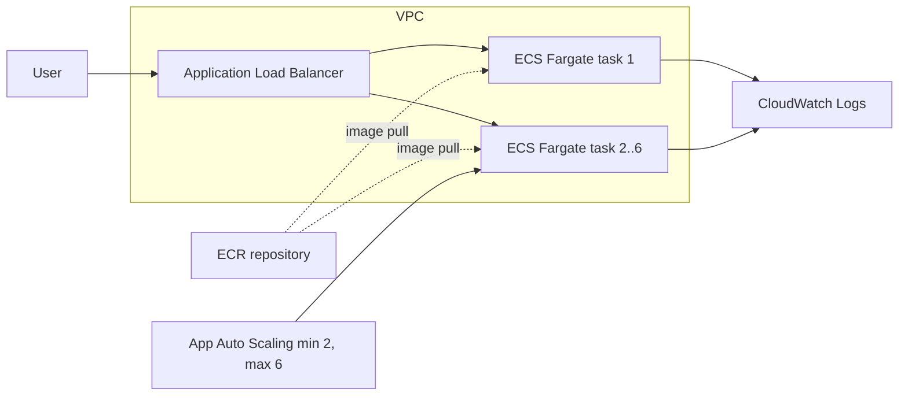
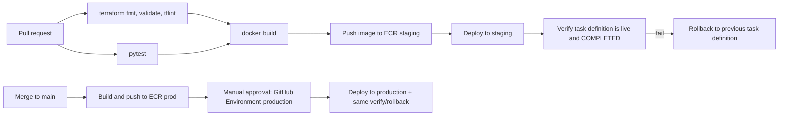

# infra-as-code-pipeline

Zero-touch deployments: Terraform (VPC, ECS Fargate, ALB, ECR) + GitHub Actions CI/CD with automatic rollback.

## Architecture

Terraform modules: `networking` (VPC, subnets, IGW, optional NAT), `security` (security groups, IAM roles), `compute` (ECR, ECS cluster/service, ALB, autoscaling), `monitoring` (log group, CPU alarm).
State: S3 bucket (versioned, encrypted) + DynamoDB lock table. Environments are Terraform workspaces (`dev`, `staging`, `prod`) with per-environment tfvars in `terraform/envs/`.

## Pipeline flow

- PR: staging deploy. Merge to main: production deploy behind a required-reviewer approval.
- Rollback layers: (1) ECS deployment circuit breaker (`rollback = true`) reverts when new tasks fail health checks; (2) the pipeline captures the previous task definition, verifies the new one is PRIMARY and COMPLETED, and re-deploys the previous one on failure. Rollback is a single `update-service` call and completes in well under a few minutes.
- Layer 1 was verified in staging by deploying a build whose `/health` returns 500: ECS rolled back to the previous revision with no downtime.

## Setup

1. Bootstrap state: `cd terraform/bootstrap && terraform init && terraform apply`
2. `cd terraform && terraform init && terraform workspace new staging`
3. `terraform apply -var-file=envs/staging.tfvars`
4. Create an IAM user for CI and add GitHub secrets `AWS_ACCESS_KEY_ID`, `AWS_SECRET_ACCESS_KEY` (never commit credentials).
5. Create GitHub Environments `staging` and `production`; add Required reviewers on `production`.
6. Open a PR to trigger lint, test, build and staging deploy.

Notes: the demo uses an admin IAM user; in a real setup use GitHub OIDC with a least-privilege role. The S3 backend still uses DynamoDB locking as required; newer Terraform supports S3-native `use_lockfile`.

## Runbook

| Symptom | Check | Fix |
|---|---|---|
| Site returns 503 | `aws ecs describe-services` events; running count | Image missing or tasks unhealthy: check ECR tag, task logs in CloudWatch |
| `CannotPullContainerError` | Image tag exists in ECR? Task has public IP or NAT? | Push the image; confirm subnets/route to internet |
| Deploy job red | Verify step log: expected vs current task definition | Fix the app; service stays on previous revision |
| Manual rollback needed | `aws ecs list-task-definitions --family-prefix <name>` | `aws ecs update-service --cluster <c> --service <s> --task-definition <previous>` |
| Terraform state lock stuck | DynamoDB table `tf-locks-capstone3` | `terraform force-unlock <LOCK_ID>` after confirming no run is active |
| High CPU alarm | CloudWatch `cpu-high` alarm | Autoscaling adds tasks up to 6; raise `max_tasks` if sustained |

## Cost estimate (ap-south-1, approximate, running 24x7)

| Item | Staging/dev | Prod |
|---|---|---|
| Fargate (2 tasks; 0.25 vCPU/0.5 GB vs 0.5 vCPU/1 GB) | ~$19 | ~$38 |
| ALB | ~$20 | ~$20 |
| NAT Gateway | $0 (tasks in public subnets) | ~$41 + data |
| ECR, CloudWatch, S3, DynamoDB | ~$1-3 | ~$1-3 |
| **Total** | **~$40/month** | **~$100/month** |

Prices are estimates; verify with the AWS Pricing Calculator. Prod code is written but was not applied to avoid NAT Gateway cost; staging was applied, tested and destroyed after the demo.

